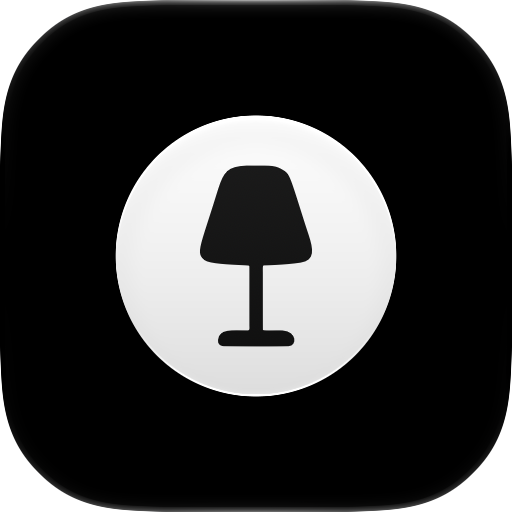

<div align="center">
  
  <h1>Swing Music para iOS 16</h1>
  <p><b>Backport não oficial do cliente iOS do Swing Music para iPhone/iPad presos no iOS 16</b></p>
  <p>
    <a href="https://github.com/op3ny/swing-ipa/releases/latest"><strong>Baixar IPA</strong></a>
    ·
    <a href="https://github.com/swingmx/ios">Cliente original</a>
    ·
    <a href="https://swingmx.com/guide/introduction.html">Documentação do Swing Music</a>
  </p>
</div>

## Por que este projeto existe

O [cliente oficial](https://github.com/swingmx/ios) do Swing Music passou a exigir **iOS 26** (as versões mais antigas do histórico exigiam iOS 18). Isso deixa fora aparelhos perfeitamente funcionais como o **iPhone 8 Plus**, que para no **iOS 16.7.x** — é o teto de sistema da família A11.

Este fork pega o código oficial, ajusta o deployment target para **iOS 16.4** e substitui as APIs recentes por equivalentes compatíveis. O resultado é um **IPA não assinado**, pensado para dispositivos **jailbroken** (onde a assinatura da App Store não é necessária).

> Não é um projeto afiliado à swingmx. O servidor continua sendo o [swingmx/swingmusic](https://github.com/swingmx/swingmusic); aqui está apenas o cliente iOS.

## O que foi adaptado

- `@Observable` / `@Bindable` / `@ObservationIgnored` → `ObservableObject` / `@ObservedObject` / `@EnvironmentObject`
- `Tab(...)` do iOS 18 → `TabView` com `.tabItem` legado
- Substituídos: `ContentUnavailableView`, `.contentMargins`, `.scrollTargetLayout/Behavior`, `.scrollClipDisabled`, `.safeAreaPadding`, `.symbolEffect`, `.glassEffect`, `GlassEffectContainer`, `MeshGradient`, `.onScrollGeometryChange`, `.presentationSizing`, `.matchedTransitionSource`, `Text.Layout`
- Renderizador de letras MeloX (iOS 17+) removido do target; stubs mantêm o resto do código compilando
- Widgets e Live Activities simplificados para iOS 16
- Build sem assinatura (`CODE_SIGNING_ALLOWED=NO`) + assinatura fake com `ldid`

Efeitos visuais e animações ficaram mais simples que no original. As funções principais — login, biblioteca, reprodução, fila, downloads, letras, widgets — continuam presentes.

## Instalação (iPhone jailbroken)

1. Instale **AppSync Unified** e **Filza** (por exemplo, repo `https://cydia.akemi.ai/`).
2. Baixe o IPA na [última release](https://github.com/op3ny/swing-ipa/releases/latest).
3. Abra o arquivo no Filza e toque em **Installer**.
4. Alternativa por SSH:
   ```sh
   installipa /caminho/SwingMusic-ios16-unsigned.ipa
   ```
5. Na primeira abertura, informe endereço, usuário e senha do seu servidor Swing Music.

Detalhes da release atual: bundle `com.swingmusic.app`, v1.0.0 (build 11), `MinimumOSVersion: 16.4`, binário arm64.

## Como o IPA é gerado

Não é necessário ter macOS: o build roda em um runner `macos-15` do GitHub Actions.

- Workflow: [`.github/workflows/build-ipa.yml`](.github/workflows/build-ipa.yml)
- Disparar manualmente: `gh workflow run "Build unsigned IPA (iOS 16)" --repo op3ny/swing-ipa`
- Ou simplesmente dar push em `main`
- O artefato fica disponível por 30 dias; as releases recebem o IPA final

### Checando antes de subir

Mesmo em Linux dá para validar a maior parte das alterações em segundos:

```sh
bash scripts/check_swift_syntax.sh   # swiftc -parse em todos os .swift
python3 scripts/check_ios16_apis.py  # aponta APIs de iOS 17+ que não compilam no alvo 16
```

Esses scripts pegam erros de sintaxe e APIs incompatíveis. Erros de tipo/disponibilidade do SDK da Apple só aparecem no build macOS, por isso o CI ainda é a etapa final.

## Funcionalidades do cliente original

**Reprodução:** streaming com qualidade selecionável (até lossless), fila com shuffle/repeat/autoplay, crossfade, timer de sono, equalizador, AirPlay, downloads offline e histórico sincronizado.

**Letras:** sincronização palavra por palavra, busca automática de letras, fallback linha a linha e créditos de composição.

**Biblioteca:** álbuns, artistas, playlists, pastas, favoritos, mixes, busca, selos de conteúdo explícito, biografias e estatísticas.

**iPhone/iPad:** layout para iPad com player landscape, widgets, Live Activity, controles na tela de bloqueio, ações de swipe e temas claro/escuro.

**Conexão:** Tailscale, domínios customizados, certificados autoassinados e relatório de problemas pelo app.

## Créditos

Baseado em [swingmx/ios](https://github.com/swingmx/ios), mantido pela comunidade Swing Music.

Agradecimentos do projeto original: [MeloX](https://github.com/youshen2/MeloX), [Apple Music-like Lyrics](https://github.com/Steve-xmh/applemusic-like-lyrics), [Spicy Lyrics](https://github.com/Spikerko/spicy-lyrics), [LDDC](https://github.com/chenmozhijin/LDDC), [LNPopupUI](https://github.com/LeoNatan/LNPopupUI), [LRCLIB](https://lrclib.net), [MusicBrainz](https://musicbrainz.org) e [Wikipedia](https://www.wikipedia.org).

## Licença

Este projeto deriva de software licenciado sob **AGPL-3.0**. O texto completo está em [`LICENSE`](LICENSE). O uso do IPA é por conta própria; ele é distribuído sem assinatura da Apple e destina-se a dispositivos jailbroken.
